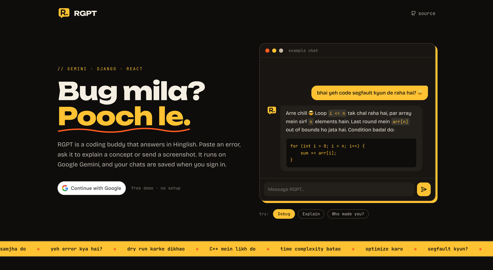
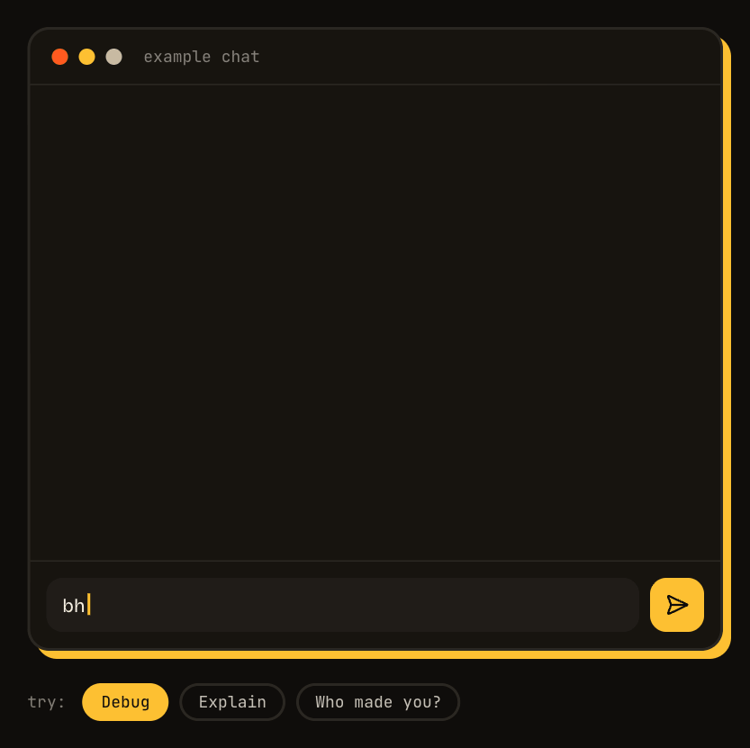
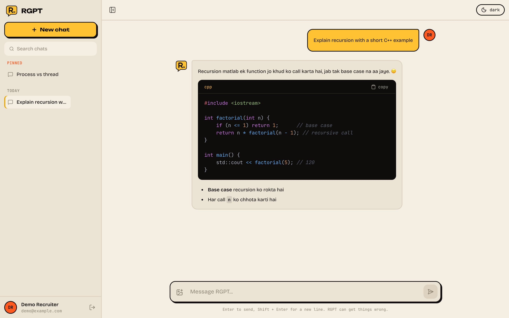
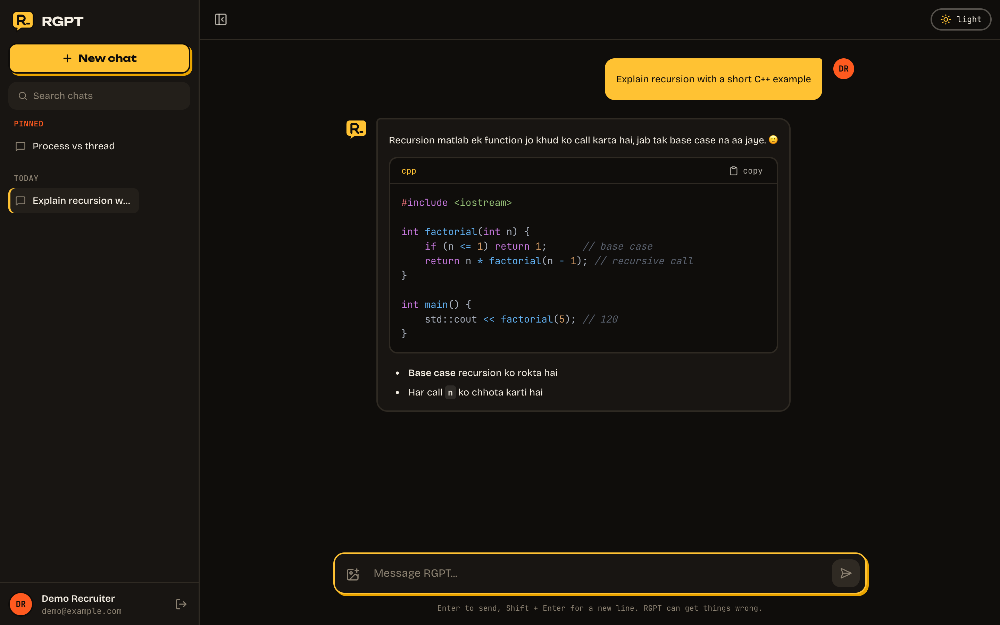
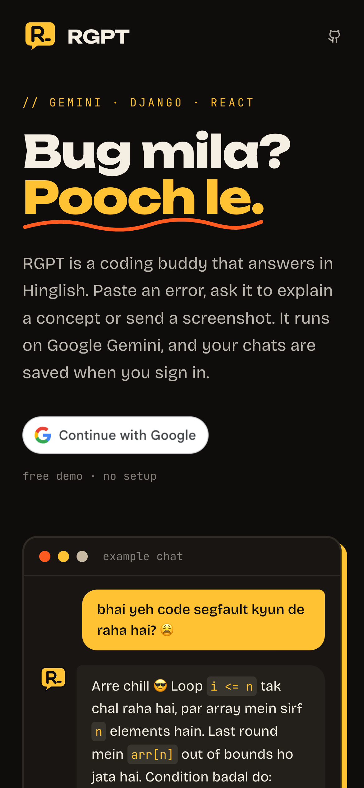
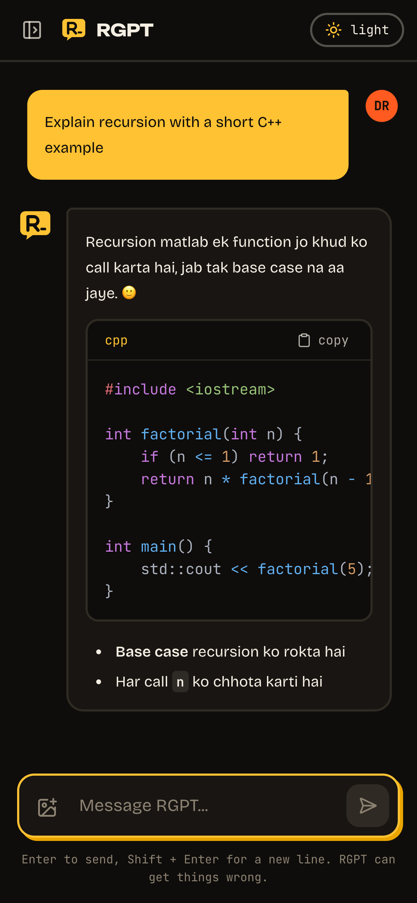
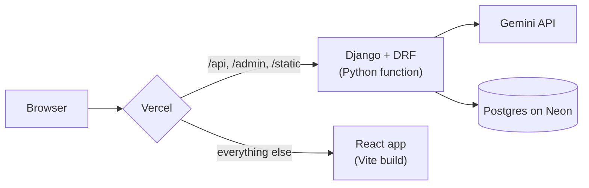

<p align="center">
  
</p>

<h1 align="center">RGPT</h1>

<p align="center">
  A coding buddy that answers in Hinglish. Paste an error, ask it to explain a concept or send a screenshot.<br />
  Built with React, Django REST Framework and Google Gemini, and deployed on Vercel.
</p>

<p align="center">
  <a href="https://rgpt-chat-app.vercel.app"><b>Live demo</b></a>
  &nbsp;·&nbsp;
  <a href="https://github.com/EDWARD-012">GitHub</a>
</p>

<p align="center">
  
  
  
  
  
</p>

<p align="center">
  
</p>

## A quick look

The landing page plays a short example chat by itself, so visitors can see what RGPT does before they sign in.

<p align="center">
  
</p>

After signing in with Google, chats are saved to your account. There's a light theme and a dark one.

<table>
  <tr>
    <td width="50%"></td>
    <td width="50%"></td>
  </tr>
</table>

It works on a phone too.

<p align="center">
  
  &nbsp;&nbsp;
  
</p>

<sub>The chat screenshots use a sample conversation on a local build.</sub>

## What it does

- Replies in Hinglish and writes code in C++ unless you ask for another language. Code blocks are highlighted and have a copy button.
- Takes an image with or without text, so you can send a screenshot of an error and ask what's wrong. Images can be up to 4 MB.
- Sends the earlier messages of a chat along with each new one, so follow-up questions work.
- Saves chats per Google account. You can pin, rename, search and delete them from the sidebar, and new chats are named after their first message.
- Falls back to other Gemini models when the main one is busy or rate limited.
- Limits each user to 40 messages an hour so the public demo can't use up the Gemini quota.

## How it works



Both parts live in one Vercel project, on one domain, so there's no CORS setup in production. The browser gets an ID token from Google Sign-In and sends it to `/api/auth/google/`. Django checks it with `google-auth` and returns a DRF token that the app sends with every request after that.

When you send a message, Django loads the recent history of that chat (30 messages by default), sends it to Gemini with the system prompt, and saves your message and the reply together once the reply arrives. If Gemini fails, nothing is saved and the app shows an error.

## Tech stack

**Frontend:** React 19, Vite 7, Tailwind CSS 4, Framer Motion, react-markdown with react-syntax-highlighter, `@react-oauth/google`, react-router and axios. Fonts are Unbounded, Bricolage Grotesque and JetBrains Mono, self-hosted through Fontsource.

**Backend:** Python 3.12, Django 5.2, Django REST Framework, the `google-genai` SDK, `google-auth`, `dj-database-url` and WhiteNoise.

**Hosting:** Vercel Services for both parts, and Postgres on Neon from the Vercel Marketplace. Locally it uses SQLite.

## Run it locally

Clone the repo:

```bash
git clone https://github.com/EDWARD-012/RGPT-Chat-App.git
cd RGPT-Chat-App
```

Copy `.env.example` to `.env` in the repo root and fill it in. The backend and the Vite dev server both read this file. Leave `DATABASE_URL` empty to use SQLite.

Start the backend (Python 3.12):

```bash
cd backend
python -m venv .venv
source .venv/bin/activate
pip install -r requirements.txt
python manage.py migrate
python manage.py runserver
```

Run the tests with `python manage.py test api`.

In a second terminal, start the frontend:

```bash
cd frontend
npm install
npm run dev
```

The Vite dev server proxies `/api`, `/admin` and `/static` to Django on port 8000, so open http://localhost:5173. Add `http://localhost:5173` to the authorized JavaScript origins of your Google OAuth client for sign-in to work locally.

## Deploying on Vercel

`vercel.json` defines two Vercel Services in one project: `frontend/` is built with Vite and `backend/` runs Django as a Python function. Requests to `/api/*`, `/admin*` and `/static/*` go to Django and everything else goes to the React app. Each build runs `migrate` when `DATABASE_URL` is set.

In the Vercel project settings, the Root Directory is the repo root and the Framework Preset is Services. Set these environment variables for Production and Preview:

| Variable | Notes |
| --- | --- |
| `DJANGO_SECRET_KEY` | Long random string |
| `GEMINI_API_KEY` | From Google AI Studio |
| `VITE_GOOGLE_CLIENT_ID` | OAuth web client ID, used by the frontend and the backend |
| `DATABASE_URL` | Added by the Neon integration when you connect a database |

`GET /api/health/` reports which of these the deployment can see, without showing their values. The optional settings are listed in `.env.example`.

Every Vercel origin that shows the sign-in button (the production domain and any preview URL you test on) has to be listed under Authorized JavaScript origins for the OAuth client in Google Cloud Console.

## Project structure

```
RGPT-Chat-App/
├── frontend/          React + Vite + Tailwind app
│   ├── public/        Favicon (the RGPT logo)
│   └── src/
├── backend/           Django + DRF API
│   ├── api/           Models, views, serializers, tests
│   └── rgpt_backend/  Settings and URLs
├── docs/screenshots/  Images used in this README
├── vercel.json        Vercel Services config
└── .env.example
```

## Contributing

Pull requests are welcome. For bigger changes, open an issue first so we can talk about it.

## License

Released under the MIT License.

---

Built by Ravi Kumar Gupta ([EDWARD7780](https://github.com/EDWARD-012)).
